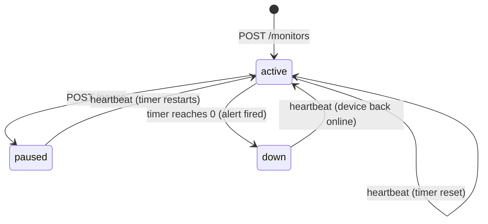
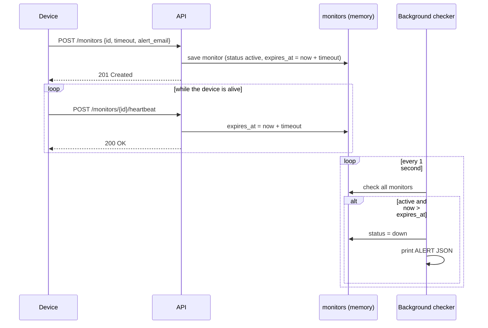

# Pulse-Check API

This is my solution to the Pulse-Check (Watchdog Sentinel) challenge. It is a Dead Man's Switch API for CritMon Servers. Each device registers a monitor with a timeout. The device has to send a heartbeat before the timeout ends. If it doesn't, the API marks the device as `down` and prints an alert.

Built with Python, FastAPI and Uvicorn. Monitors are stored in memory (a Python dictionary).

## Architecture

### State diagram

A monitor is always in one of three states: `active`, `paused` or `down`.



### Sequence diagram



### How it works

When a monitor is created I save `expires_at = now + timeout`. A heartbeat just moves `expires_at` forward again. A background thread starts with the server and checks all monitors every second. If a monitor is `active` and the current time is past its `expires_at`, it changes to `down` and the alert is printed. Paused and down monitors are skipped, so they don't send alerts.

## Setup

You need Python 3.10 or newer.

```bash
git clone https://github.com/sand02004/AmaliTech-DEG-Project-based-challenges.git
cd AmaliTech-DEG-Project-based-challenges/backend/Pulse-Check

python -m venv venv
venv\Scripts\activate        # Windows
# source venv/bin/activate   # Mac / Linux

pip install -r requirements.txt
python -m uvicorn main:app --reload
```

The API runs at `http://127.0.0.1:8000`. You can test every endpoint from `http://127.0.0.1:8000/docs`.

## API Endpoints

| Method | Endpoint | What it does |
|---|---|---|
| POST | `/monitors` | Create a monitor |
| POST | `/monitors/{id}/heartbeat` | Reset the timer (also un-pauses) |
| POST | `/monitors/{id}/pause` | Pause the monitor |
| GET | `/monitors/{id}` | See the monitor's status |

### Create a monitor

`POST /monitors`

```json
{"id": "device-123", "timeout": 60, "alert_email": "admin@critmon.com"}
```

Response `201 Created`:

```json
{"message": "Monitor device-123 created"}
```

- `409` if a monitor with that id already exists
- `422` if a field is missing or `timeout` is 0 or negative

### Send a heartbeat

`POST /monitors/device-123/heartbeat`

Response `200 OK`:

```json
{"message": "Heartbeat received"}
```

- `404` if the monitor doesn't exist

The timer goes back to the full timeout. If the monitor was paused or down, it becomes `active` again.

### Pause a monitor

`POST /monitors/device-123/pause`

Response `200 OK`:

```json
{"message": "Monitor device-123 is paused"}
```

- `404` if the monitor doesn't exist

While paused, no alert is sent. The next heartbeat un-pauses it.

### Get a monitor's status

`GET /monitors/device-123`

Response `200 OK`:

```json
{"id": "device-123", "status": "active", "timeout": 60, "seconds_left": 42}
```

- `404` if the monitor doesn't exist
- `seconds_left` is `null` when the monitor is paused or down

### The alert

When a timer runs out, this is printed in the server console:

```json
{"ALERT": "Device device-123 is down!", "time": 1763712000.12}
```

## Developer's Choice: GET /monitors/{id}

I added an endpoint to check a monitor's status.

Without it, the only way to know if a device is up or down is to watch the server console. That isn't practical for a support engineer. With this endpoint you can:

- check that a new device is being tracked
- see how many seconds are left before an alert fires
- confirm a device is back to `active` after a repair
- check that a device is still paused during maintenance

For a monitoring system, being able to see the current state is as important as the alert itself.

## Design choices and limitations

- I store an expiry time for each monitor and use one background thread to check them all, instead of creating a separate timer for every device. It is simpler, and a heartbeat only needs to update one value.
- Creating a monitor with an id that already exists returns `409` so an existing monitor isn't overwritten.
- Data is kept in memory, so everything is lost when the server restarts. In a real system I would use a database or Redis.
- The checker runs every second, so an alert can be up to about one second late.
- The API and the checker thread share the same dictionary. In production I would add a `threading.Lock` to avoid race conditions.
- Alerts are only printed. The next step would be sending an email to `alert_email` or calling a webhook.